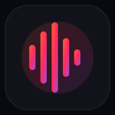
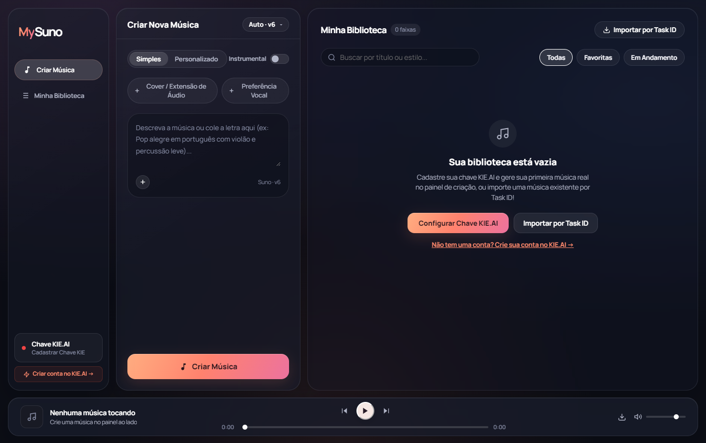

<div align="center">



# MySuno

### Sua ideia. Sua letra. Sua voz.

Um estúdio de música com IA que cabe no navegador — com visual de vidro, instalação no Windows e Android e a sua própria chave KIE.AI.

[](https://ngsaints.github.io/MySuno/)
[](https://kie.ai?ref=e8f6dd065f9a24fc91437577241fd3e6)

[](https://github.com/ngsaints/MySuno/actions/workflows/pages.yml)


</div>



## 🎵 O que dá para fazer

- Criar músicas a partir de uma ideia ou de uma letra completa.
- Escolher entre modo simples e personalizado.
- Consultar os modelos atuais da KIE e usar **Automático** para selecionar a versão mais recente documentada.
- Usar áudio enviado ou gravado no microfone para cover e extensão.
- Cadastrar sua própria voz com amostra, frase oficial de verificação e confirmação da KIE.
- Organizar a biblioteca local, favoritar, ouvir e baixar as faixas.
- Importar uma geração pelo Task ID.
- Instalar o app pelo navegador, sem Android Studio ou instalador de desktop.

> **Começando agora?** [Crie sua conta KIE.AI pelo convite do projeto](https://kie.ai?ref=e8f6dd065f9a24fc91437577241fd3e6), gere sua chave no painel da KIE e cadastre-a no MySuno. Esse link de indicação pode gerar comissão para o criador do projeto.

## 🚀 Comece em poucos passos

1. [Abra o MySuno](https://ngsaints.github.io/MySuno/).
2. Clique em **Chave KIE.AI**, informe sua própria chave e teste a conexão.
3. Digite sua ideia ou cole uma letra no modo personalizado.
4. Escolha o estilo, confira o modelo e clique em **Criar Música**.
5. Acompanhe a geração e ouça o resultado na biblioteca.

O uso do aplicativo não inclui créditos de geração. Operações e cobranças dependem da conta e das condições da KIE. [Cadastre-se pelo link de indicação](https://kie.ai?ref=e8f6dd065f9a24fc91437577241fd3e6).

## 📲 Instale como aplicativo

| Plataforma | Como instalar |
| --- | --- |
| **Android · Chrome** | Abra o site, toque em **Instalar MySuno** quando disponível ou use o menu do navegador → **Instalar app / Adicionar à tela inicial**. |
| **Windows · Edge ou Chrome** | Abra o site e use **Instalar MySuno** ou o ícone de instalação na barra de endereço. |
| **Outros navegadores** | O site funciona no navegador; a opção de instalação depende do suporte de cada um. |

A instalação abre uma janela própria e usa os mesmos dados locais do site no navegador/perfil em que foi instalada.

## 🔄 Atualizações sem reinstalar

O app verifica novas versões ao voltar para a tela, recuperar a conexão e periodicamente enquanto está aberto. Quando uma atualização estiver pronta, aparecerá **Atualizar agora**.

- O MySuno evita aplicar a atualização enquanto detecta uma geração ou gravação em andamento.
- A chave e a biblioteca continuam no armazenamento local: o processo de atualização não as remove.
- A interface pode abrir offline depois do primeiro carregamento completo; gerar música, enviar áudio e consultar a KIE exige internet.
- A chegada de uma atualização depende da publicação no GitHub Pages, da conexão e do navegador. Não é uma atualização silenciosa garantida em tempo real.

**Mantenha o mesmo endereço e navegador/perfil.** Limpar os dados do site, usar navegação privada, trocar de domínio, de perfil ou de aparelho pode remover ou separar os dados. O histórico guarda metadados e links; os arquivos de áudio continuam sujeitos à retenção da KIE. Baixe as músicas que quiser conservar.

## 🔐 Sua chave pertence a você

O MySuno usa **BYOK — Bring Your Own Key**.

| Dado | Onde fica |
| --- | --- |
| Chave KIE.AI | `localStorage` do navegador do próprio usuário. Não é incluída no código ou no GitHub. |
| Autenticação | Enviada diretamente à KIE no cabeçalho da requisição. |
| Histórico e vozes cadastradas | Metadados locais no navegador. |
| Gravações e letras | Enviadas à KIE somente para as operações solicitadas pelo usuário. |
| Cache offline da PWA | Somente arquivos públicos da interface. Não guarda requisições autenticadas nem áudios enviados. |

A versão GitHub Pages não tem servidor do projeto recebendo chaves. Não há chave compartilhada, telemetria própria ou sincronização da biblioteca. O armazenamento local não é um cofre criptografado: quem tiver acesso ao seu perfil de navegador pode acessar seus dados. Use o app apenas em aparelhos e perfis de confiança.

## 🎙️ Usando sua voz

1. Abra **Preferência Vocal** e o assistente de voz.
2. Grave ou envie uma amostra com pelo menos 10 segundos.
3. Aguarde a frase oficial e grave sua leitura.
4. Envie a verificação e espere a confirmação de disponibilidade.
5. Ative sua voz e crie uma música com vocais.

Se a conexão cair após o envio, **Retomar verificação da voz** consulta o pedido existente sem reenviar automaticamente sua criação. Use apenas a sua voz ou uma voz para a qual tenha autorização.

## 🧩 Como os modelos se mantêm atuais

O catálogo é extraído da [especificação oficial de geração musical da KIE](https://docs.kie.ai/suno-api/generate-music).

- **GitHub Pages:** o GitHub Actions consulta a especificação na publicação e tem uma execução agendada a cada 30 minutos. Execuções agendadas dependem da disponibilidade e das regras do GitHub.
- **App aberto:** o navegador consulta o catálogo publicado a cada cinco minutos e ao recuperar o foco.
- **Modo automático:** prioriza a versão numérica mais recente e, na mesma versão, o modelo completo.
- **Sem conexão:** um catálogo confirmado há menos de 24 horas pode ser usado com indicação de que está salvo. Sem catálogo válido, a geração fica bloqueada.

Um nome documentado não garante saldo, disponibilidade instantânea do provedor nem compatibilidade de todas as operações futuras.

## 🛠️ Execute localmente

Requer Node.js 22 ou superior e npm.

```bash
npm ci
npm run build:web
npm run preview:web
```

Abra o endereço indicado pelo comando, normalmente **[localhost:4173/MySuno/](http://localhost:4173/MySuno/)**. Essa prévia usa os mesmos arquivos estáticos preparados para o Pages.

Para desenvolvimento com consulta do catálogo pelo servidor Node:

```bash
node server.js
```

A interface fica em **[localhost:3000](http://localhost:3000)**. Para abrir o cliente Electron existente, use `npm start`.

### Verificações

```bash
npm test
npm run build:web
```

Os testes automatizados usam respostas simuladas e não consomem créditos KIE. A geração real depende da conta do usuário.

## ☁️ Publicação no GitHub Pages

O workflow [pages.yml](.github/workflows/pages.yml) publica apenas `dist/web`, gerado a partir dos arquivos públicos de `src/` e do catálogo oficial. Configure **Settings → Pages → Source → GitHub Actions** no repositório.

O deploy acontece após alterações na branch `main`, execução manual do workflow ou execução agendada. Nenhuma chave KIE precisa ser cadastrada nos secrets do repositório.

## 💛 Apoie o projeto

Se o MySuno facilitar suas criações, [crie sua conta na KIE.AI pelo link de indicação do autor](https://kie.ai?ref=e8f6dd065f9a24fc91437577241fd3e6).

Feito por **[ngsaints](https://github.com/ngsaints)**. MySuno é um cliente independente, sem vínculo oficial com KIE.AI ou Suno. A fonte Manrope é distribuída com sua [licença própria](src/assets/fonts/OFL-Manrope.txt).
